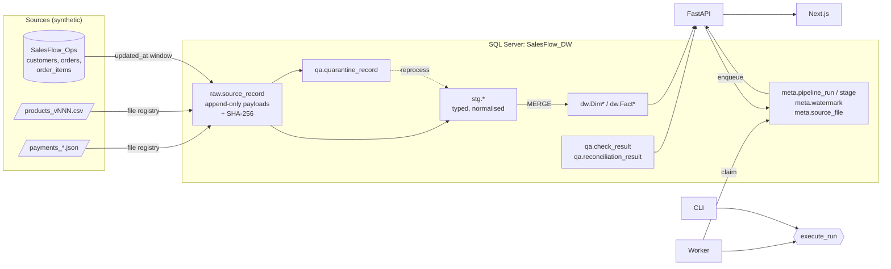

# Architecture

The same diagram, drawn for the UI, is on the app's **How it works** page.

## Components

| Component | Location | Role |
|---|---|---|
| Generator | `backend/salesflow/generator/` | Deterministic baseline + 11 scenarios + manifest with expected outcomes |
| Reference oracle | `generator/reference.py` | Independent Python implementation of every metric, used for expectations |
| Migrations | `backend/salesflow/migrations/{ops,dw}/V*.sql` | Versioned SQL, applied by `migrate.py` |
| Pipeline | `backend/salesflow/pipeline/` | extract, files, staging/validate, load, quality, reconcile, executor, runs, worker |
| Analytics | `backend/salesflow/analytics/` | Parameterised SQL for every API read; metric definitions |
| API | `backend/salesflow/api/app.py` | FastAPI app, validation, structured errors, auth guard |
| Web | `frontend/src/` | Next.js App Router pages and components |

## Run lifecycle

1. **Request.** The API (`POST /api/pipeline/runs`) or CLI inserts a `queued` row with `active_slot = 1`.
   A filtered unique index makes a second queued/running run fail with HTTP 409.
2. **Claim.** A worker atomically sets `running` (`UPDLOCK, READPAST`). The CLI claims its own run directly.
3. **Execute** (`executor.execute_run`, holding `sp_getapplock('salesflow_pipeline')`):
   * `extract_source_db`: per table, read `(watermark − overlap, MAX(updated_at)]` ordered by
     `(updated_at, key)`; land rows whose canonical-JSON checksum differs from the latest raw version.
     **Committed.**
   * `ingest_files`: register each new (name, SHA-256) delivery as landed, duplicate, conflict or
     rejected (schema). Land changed records. **Committed.**
   * One transaction from here on:
     `stage_validate` → `load_warehouse` → `quality_checks` (gate) → `reconcile` → `publish`
     (entity stats, watermarks, file statuses, run `succeeded`).
4. **Progress.** Stage rows are written on a separate autocommit connection, so the UI shows real
   state while the main transaction is open. A heartbeat thread updates `heartbeat_at_utc`.
5. **Failure.** Anything raised rolls back the main transaction; the run is marked `failed` with
   stage, code and message. Stages that had completed inside the rolled-back transaction are labelled
   as rolled back. Raw landings remain and are reused by the retry.
6. **Recovery.** Each worker loop fails `running` runs whose heartbeat is older than 60 s *and* whose
   pipeline lock is free (the process died): `WORKER_INTERRUPTED`.

## Modes

| Mode | Extraction | Files | Staging candidates |
|---|---|---|---|
| `initial` | whole source tables | new deliveries | latest raw versions not yet accepted and not quarantined |
| `incremental` | watermark window | new deliveries | same |
| `reprocess` scope `quarantine` | none | none | open quarantine records (optionally by error code / entity) |
| `reprocess` scope `run` | none | none | latest raw versions landed by a given run (forced re-validation) |

## File delivery rules

* Same name and same bytes as a known delivery: ignored (not a new delivery).
* Same bytes, new name: `duplicate` (records not re-read).
* Same name as an accepted file, different bytes: `conflict` (held, not processed).
* Header or structure contract broken: `rejected` (file-level quarantine). A corrected file may then
  reuse the rejected file's name.
* Catalog files are full snapshots `products_vNNN.csv`; an older version never overwrites a newer one.
* Payment corrections arrive as new batch files; transactions are upserted by `transaction_id`.

## Security posture

* API binds to `127.0.0.1`. CORS lists explicit origins only.
* All SQL is parameterised; dynamic identifiers come from code constants and whitelists, never input.
* Mutations (run, retry, reprocess, quarantine review, dev scenario apply) need mutations enabled and,
  when `SALESFLOW_ADMIN_TOKEN` is set, a matching `X-SalesFlow-Admin-Token`. In `production` they are
  refused unless a token is configured. `SALESFLOW_READ_ONLY=true` gives a public read-only demo.
* Fault injection (`fail_at`) and scenario endpoints are refused in production.
* Reset is CLI-only with layered guards (see README).
